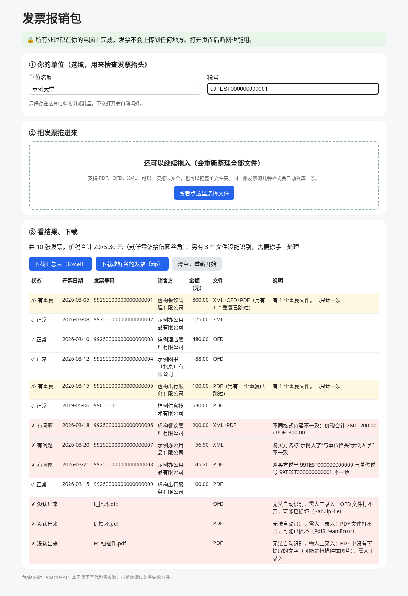

<p align="right"><a href="README.md">简体中文</a> | <strong>English</strong></p>

# fapiao-kit · Chinese e-invoice reimbursement pack

   

> Author: **Labulaka** (GitHub [@labulaka-ai](https://github.com/labulaka-ai)) · WeChat official account「**时空AI深水区**」

[Why](#why-i-built-this) · [Features](#features) · [Web page (no install)](#web-page-for-people-who-dont-use-a-terminal) · [CLI & Python API](#cli--python-api) · [Agent skill](#use-as-an-agent-skill) · [Credibility](#credibility-tests-and-verification) · [Limitations](#known-limitations)

Turn a pile of Chinese electronic invoices (数电票 / 发票) in PDF, OFD and XML into a reimbursement pack, **on your own computer**: the different formats of the same invoice are merged into one record, duplicates are counted once, copies are renamed to `date_seller_total_number`, and you get an Excel summary with totals and the amount in Chinese uppercase (大写). It also checks that the buyer name and tax ID match your organisation.

There are two ways to use it. **Non-technical users** open a web page, drag the invoices in, and download the Excel file and a zip of renamed copies. **Developers and AI agents** use the CLI, the JSON output and the Python API. Both run **the same Python code** (the page runs it in the browser with Pyodide), so the tests below cover both.



---

## Why I built this

Sorting invoices for reimbursement is frequent, low-skill and error-prone work, and it usually falls on administrative staff and students without a technical background:

- **One invoice, three files**: a 数电票 can be downloaded as PDF, OFD and XML, so the same invoice often appears several times and gets counted twice;
- **Duplicate claims are an audit finding**: e-invoices can be printed again and again; "re-printed duplicate reimbursement" shows up in local budget audits (Aohan Banner government, 2024-09), and some universities refuse invoices that have not been verified (China University of Geosciences (Wuhan), 2025-05);
- **The XML is the original**: tax authorities say only the digitally signed XML can be booked on its own; PDF/OFD are layout files (Shanghai Tax FAQ, 2023-08). So when formats disagree, the XML wins and the user must be told;
- **Rejected by finance**: one wrong character in the buyer name or a wrong tax ID is one of the most common reasons for rejection.

Among existing tools, the open-source [fapiao-print (发票酱)](https://github.com/erma0/fapiao-print) is good, but it focuses on print layout and its desktop app is Windows-only; most commercial apps upload invoices to the cloud. This project does one job, the reimbursement pack (**merge, dedupe, rename, summarise, check the buyer**), fully locally, with automated tests for every step.

## Features

| Command | What it does |
|---|---|
| `scan` | Parses XML / OFD / text-based PDF and extracts number, code, issue date, seller, buyer, tax IDs, amount, tax, total and category; merges formats of the same invoice into one record (**XML first**) and reports each field that differs between formats; dedupes by invoice number |
| `check` | Checks against a rule file: buyer name / tax ID equal your organisation, formats agree, amount + tax = total, uppercase amount matches, date range, per-category limits, negative (red-letter) invoices; exit code 1 on errors |
| `rename` | Copies renamed **copies** into a new directory (default `{date}_{seller}_{total}元_{number}`), adds a suffix on name clashes, skips duplicates, puts unrecognised files into `未识别/`; **never touches the originals** |
| `export` | Excel workbook: detail rows (invoice numbers stored as text, no scientific notation), totals, **Chinese uppercase amount**, count, per-category subtotals and a "to fix" sheet |

Every command supports `--json`.

**If it can't read something, it says so**: scanned / image-only PDFs (no text layer) and broken files are listed separately as "needs manual entry"; no numbers are guessed.

## Web page: for people who don't use a terminal

`web/index.html` is a static page with three steps: ① enter your organisation's name and tax ID once (stored only in this browser) → ② drag invoice files or a whole folder in → ③ download the Excel summary and the zip of renamed invoices (the zip also contains the summary). Problem invoices are highlighted in red with a one-line plain-language explanation.

- **No upload**: a Content-Security-Policy forbids requests to anywhere except the page's own origin, and invoices are processed in browser memory only. The tests prove this (see below).
- **Works offline**: once the page has loaded you can disconnect and keep working.
- The first visit loads about 14 MB of in-browser Python runtime (Pyodide); the browser caches it afterwards.

Run it locally (developers / early testers):

```bash
python scripts/fetch_web_deps.py      # downloads Pyodide and pypdf into web/vendor/ (pinned version + SHA-256)
python -m http.server 8000            # run from the repository root
# open http://localhost:8000/web/index.html
```

> The page must be served over http (double-clicking the html file makes the browser refuse to load the runtime). The plan is to publish it on GitHub Pages so ordinary users can just click a link.

## CLI & Python API

```bash
git clone https://github.com/labulaka-ai/fapiao-kit.git
cd fapiao-kit
python -m venv .venv && .venv/bin/pip install -r requirements.txt   # only pypdf
```

```bash
.venv/bin/python -m fapiao_kit.cli scan invoices/
.venv/bin/python -m fapiao_kit.cli check invoices/ --rules rules/example.toml
.venv/bin/python -m fapiao_kit.cli rename invoices/ -o invoices-renamed/
.venv/bin/python -m fapiao_kit.cli export invoices/ -o summary.xlsx
.venv/bin/python -m fapiao_kit.cli scan invoices/ --json
```

After `pip install .` you can also run `fapiao scan ...`.

```python
import fapiao_kit as fk
records = fk.scan("invoices/", rules={"buyer_name": "示例大学", "buyer_tax_id": "99TEST000000000001"})
fk.export_xlsx(records, "summary.xlsx")
fk.rename(records, "invoices-renamed/")
print(fk.to_json(records))
```

`demo/samples/` holds 18 synthetic sample files (a PDF+OFD+XML set, duplicates, a tampered PDF, wrong buyer name, wrong tax ID, an old-style invoice, broken files, a scan…):

```bash
.venv/bin/python -m fapiao_kit.cli check demo/samples --rules rules/example.toml
```

## Use as an agent skill

`SKILL.md` at the repository root is the entry point for AI agents (Claude Code, Codex, Cursor and other skill-compatible runtimes): when to trigger, the call order `scan → check → user confirms → rename / export`, the JSON fields, and what is not allowed (never modify originals, never upload invoice contents, always tell the user about mismatches, never guess unrecognised files, no authenticity verification).

## Credibility: tests and verification

**Test suite** (actual local `pytest` result: **97 passed**, 0 failed, 0 skipped):

- **Synthetic samples only, no real invoices**: `tests/gen/samples.py` generates XML, OFD (three variants: custom tags / no tags with per-character DeltaX / CustomData + multi-segment TextCode) and text-based PDF (数电票 layout and the old VAT e-invoice layout). Every sample carries "测试样例 非真实发票" (test sample, not a real invoice), fictional companies, tax IDs starting with `99TEST`, invoice numbers in a `99…` range, and no seals; a test enforces these constraints;
- **Field-level assertions**: 15 sample files × 12 fields compared with the generator's ground truth, plus a random round-trip test: 30 random invoices × 5 files each (XML, 3 OFD variants, PDF) must parse back to exactly the original fields;
- **Merge & dedupe**: the three-format set becomes one record with XML as primary; a tampered PDF (different total) loses to the XML and the mismatch is reported; renamed duplicate copies are caught by hash; **two invoices with the same date, amount and seller but different numbers are never merged**; files without a number are only flagged as "suspected duplicate";
- **Rename**: hashes and mtimes of every original file are unchanged; copies are byte-identical; clashes get a suffix; a non-empty output directory is refused;
- **Excel read-back**: openpyxl checks that totals equal the sum of rows, the uppercase amount, 20-digit numbers stored as text, category subtotals and the "to fix" sheet; LibreOffice also opens the exported xlsx and converts it to CSV to check the totals (skipped if LibreOffice is not installed);
- **Rules**: each rule has a "detects" case and a "no false positive" case (full/half-width brackets, spaces and tax-ID case are not errors);
- **CLI**: exit codes and JSON structure for every command; CLI output equals Python API output;
- **Web end-to-end (Playwright + Chromium)**: drags the 18 sample files onto the page → checks row count, red rows and totals → clicks both download buttons and reads the xlsx and zip back in Python;
  - **Zero outbound requests**: every network request is recorded and anything not going to the local test server is intercepted; the test asserts zero http(s) requests from drop to the end of the downloads and no external request at any time; as a negative control, a deliberate `fetch` to an external URL from the page must fail (blocked by the CSP);
  - **Offline**: after loading, the browser is switched to offline mode and processing still completes;
  - **Consistency**: for the same samples, the JSON produced in the browser (Pyodide) is identical, field by field, to the local Python output.

CI (GitHub Actions, `.github/workflows/test.yml`) downloads the web dependencies, installs Chromium and LibreOffice, and runs everything. Without `web/vendor/` or Chromium, the 5 browser tests are skipped and the rest still run.

**Not yet verified** (stated honestly): no spot checks against real invoices yet. The XML element names, OFD structure and PDF layout of the samples were written from public information and may differ from what real issuing software produces in different regions. Real-invoice spot checks will only be done locally, never committed or uploaded; if a layout is not recognised, please open an issue with **redacted** diagnostics.

## Known limitations

- **Text layer required**: scans, photos and image-only PDFs get no OCR, only a "needs manual entry" flag;
- **Invoice types**: 数电 special / ordinary VAT invoices and old VAT e-invoices (code + number). Railway e-tickets, flight itineraries, toll and fiscal receipts have no dedicated handling yet;
- **Not validated on real invoices** (see above); the PDF test samples use reportlab's built-in CID font rather than the embedded fonts in real invoices;
- **No authenticity verification**: that needs the network and a CAPTCHA, and this tool stays offline; use the State Taxation Administration's official verification site;
- **No cross-batch ledger**: duplicates are caught within one batch, but invoices reimbursed last month are not remembered (planned);
- **No merged print PDF or reimbursement-form filling** (planned); the web page cannot take a zip archive directly yet;
- The web page must be served over http and loads ~14 MB the first time; automated tests run on Chromium only (Firefox, Safari and phones untested).

## Repository layout

```
fapiao-kit/
├── SKILL.md                 # agent entry point
├── README.md / README.en.md
├── LICENSE                  # Apache-2.0
├── requirements.txt         # runtime: pypdf
├── requirements-dev.txt     # tests: pytest, reportlab, openpyxl, playwright
├── fapiao_kit/              # cli, api, parsers, layout, merge, rules, rename, export/xlsx, money
├── web/                     # index.html + app.js + style.css (vendor/ not committed)
├── scripts/fetch_web_deps.py
├── rules/example.toml       # example rule file (fictional data)
├── demo/samples/            # synthetic samples (测试样例 非真实发票)
├── tests/                   # pytest + Playwright; tests/gen/ is the sample generator
└── .github/workflows/test.yml
```

## License

- Code: Apache-2.0, see `LICENSE`.
- The web runtime Pyodide (MPL-2.0) and pypdf (BSD-3-Clause) are not distributed with this repository; `scripts/fetch_web_deps.py` downloads pinned versions. See `NOTICE`.
- All invoices in `demo/` and produced by `tests/gen/` are synthetic test data marked "测试样例 非真实发票" and have no legal effect. The tool only reads invoices; it cannot issue or modify them.
- This tool does not replace official verification and takes no responsibility for reimbursement outcomes; follow your organisation's finance rules.

---

**Author**: Labulaka ([@labulaka-ai](https://github.com/labulaka-ai)), PhD student in spatio-temporal big data
**WeChat official account**:「时空AI深水区」
